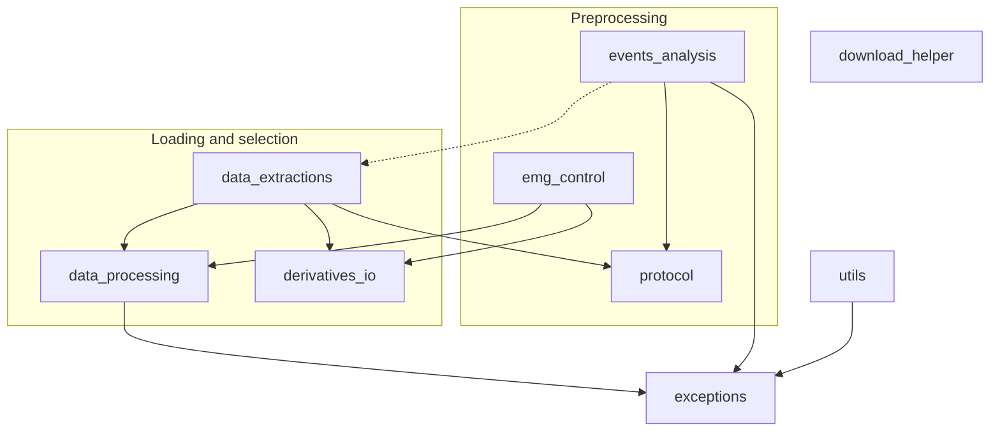

# The code

The repository holds the shared Python package `innerspeech`, the scripts that use it,
and the MATLAB program that ran the experiment.

## Repository map

```text
Inner_Speech_Dataset/
├── src/innerspeech/                  the package (installed with pip/uv)
├── Python_Processing/
│   ├── InnerSpeech_preprocessing.py  raw data → derivatives
│   ├── PSD_representation.py         power spectra → results/psd
│   ├── TFR_representations.py        time-frequency → results/tfr
│   └── Plotting/                     ERP, PSD, ITC and TFR figures → results/figures
├── Raw_data_download_tutorial.py     download the .bdf recordings
├── Derivatives_download_tutorial.py  download the preprocessed files
├── Database_exploration_tutorial.ipynb  tutorial, also on Colab
├── checks/                           compare a local copy with the published dataset
├── bids/                             write the BIDS sidecars and the 2.2.0 derivatives files
├── tests/                            automated tests on synthetic data
├── Stimulation Protocol - MatLab/    the Psychtoolbox program of the experiment
├── docs/, mkdocs.yml                 this website
├── pyproject.toml, uv.lock           dependencies and tool settings
└── README.md
```

## The package

| Module | Use it to |
| --- | --- |
| [`download_helper`](api/download_helper.md) | download raw data or derivatives from OpenNeuro, any version |
| [`data_extractions`](api/data_extractions.md) | load trials as NumPy arrays or MNE Epochs, read raw recordings |
| [`data_processing`](api/data_processing.md) | select conditions, classes, time windows and frequency bands |
| [`derivatives_io`](api/derivatives_io.md) | read and write the files of `derivatives/` (paths, `events.tsv`, `report.json`, legacy formats) |
| [`events_analysis`](api/events_analysis.md) | check and correct event sequences, build the trial table |
| [`protocol`](api/protocol.md) | the event grammar of the experiment and the per-session exceptions |
| [`emg_control`](api/emg_control.md) | tag trials with mouth movements |
| [`utils`](api/utils.md) | names, channel groups and folders |
| [`exceptions`](api/exceptions.md) | the error types of the package |

How the modules depend on each other:



`download_helper` stands alone: it only needs `datalad` and `git-annex`.

## Where things happen

| Question | Look at |
| --- | --- |
| Which trigger codes exist and in which order? | `innerspeech.protocol.INNER_SPEECH` |
| What was done to a specific session? | `innerspeech.protocol.KNOWN_ISSUES`, and the session's `report.json` |
| How are missing triggers restored? | `innerspeech.events_analysis.event_correction` |
| How is a trial tagged as EMG-contaminated? | `innerspeech.emg_control.emg_control_session` |
| What are the column names and file names of the derivatives? | `innerspeech.derivatives_io` |
| Which filters, epochs and ICA settings were used? | `Python_Processing/InnerSpeech_preprocessing.py` |
