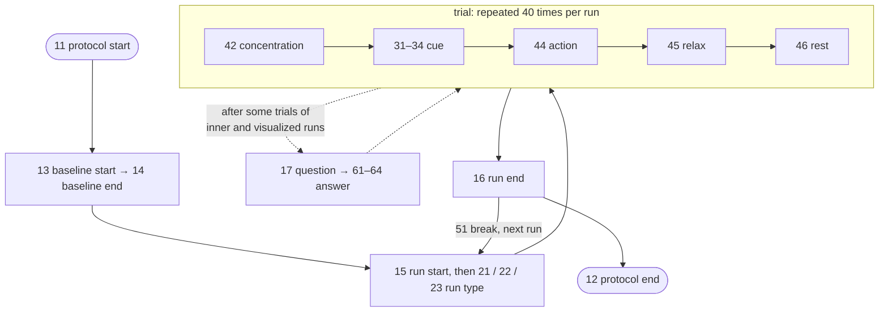

# Event codes

The stimulation computer sent a code to the EEG system at every step of the protocol.
The codes are stored in the Status channel of each `.bdf` recording and listed, one row
per trigger, in the raw `sub-XX_ses-YY_task-innerspeech_events.tsv` files.

## Code table

| Code | `trial_type` | Meaning |
| ---: | --- | --- |
| 11 | `protocol_start` | Start of the protocol (the paper's Table 3 says 1) |
| 12 | `protocol_end` | End of the protocol |
| 13 | `baseline_start` | Start of the 15 s baseline |
| 14 | `baseline_end` | End of the baseline |
| 15 | `run_start` | Start of a run |
| 16 | `run_end` | End of a run |
| 21 | `run_pronounced` | The run is pronounced speech |
| 22 | `run_inner` | The run is inner speech |
| 23 | `run_visualized` | The run is visualized condition |
| 42 | `concentration` | Start of a trial (concentration interval) |
| 31 | `cue_up` | Cue *arriba* (up): start of the cue interval |
| 32 | `cue_down` | Cue *abajo* (down) |
| 33 | `cue_right` | Cue *derecha* (right) |
| 34 | `cue_left` | Cue *izquierda* (left) |
| 44 | `action` | Start of the action interval |
| 45 | `relax` | Start of the relax interval |
| 46 | `rest` | Start of the rest interval |
| 17 | `question` | Attention control: question shown |
| 61–64 | `answer_up` … `answer_left` | Answer given: up, down, right, left |
| 51 | `inter_run_rest` | Rest between runs |
| 65536 | `spurious` | Spurious trigger of unknown origin (start of every recording and a few within sessions); not part of the protocol |

The `condition` column of the raw events files gives the condition of the run each
trigger belongs to (`pronounced`, `inner`, `visualized`, or `n/a` outside runs).

!!! note "Trials are anchored on the cue"

    The epochs in `derivatives/` are cut around the **cue** codes 31–34, from 0.5 s
    before (the start of the concentration interval) to 4 s after (the end of the
    relax interval). The `sample` column of the derivatives' `events.tsv` is the sample
    of the cue in the raw 1024 Hz recording.

## The expected sequence

A session follows a fixed grammar: baseline, then runs made of trials, with optional
questions after a trial. The event correction uses exactly this grammar, written down
in [`innerspeech.protocol.INNER_SPEECH`](../code/api/protocol.md).



## Missing triggers and how they are restored

A handful of triggers are missing from the recordings: up to four per session,
usually a trial-interval code (42, 44, 45 or 46), sometimes a cue or an answer. A missing cue
would silently drop a trial, so the preprocessing checks every session against the
grammar above and restores what is missing. [Sessions at a glance](sessions.md) lists
the corrections of every session.

The correction (`innerspeech.events_analysis.event_correction`) works like a spell
checker for event sequences:

1. **Ignore** the spurious code 65536.
2. **Align** the recorded codes with the grammar using dynamic programming. Inserting a
   missing event costs 1, dropping a recorded event costs 2.5, so up to two missing
   events are inserted before a recorded event is treated as out of sequence.
3. **Insert** each missing event at a fixed offset after the previous one (the typical
   spacing of the protocol, e.g. 563 samples between concentration and cue), so trials
   can still be epoched.
4. **Fill in** what the recording cannot tell:
    - a missing **cue** gets the class recorded least often in the session, since every
      session is balanced across the four classes; the trial is flagged with
      `cue_inferred = True` in `events.tsv`;
    - a missing **answer** gets the placeholder code 61 and counts as a wrong answer.
5. **Validate** the counts: one protocol start and baseline, as many 42/44/45/46 as cues,
   one answer per question, and matching run starts, ends and breaks.

Every inserted, dropped or ignored event is written to the session's `report.json`
under `Event_corrections`:

```json
"Event_corrections": [
  {"sample": 0, "code": 65536, "action": "ignored", "reason": "hardware artefact"},
  {"sample": 582738, "code": 42, "action": "inserted", "reason": "missing trial_start"}
]
```

Two sessions need more than the grammar. They are listed in
`innerspeech.protocol.KNOWN_ISSUES` and described in
[Notes](notes.md#per-session-exceptions): sub-10 ses-01, where a spurious trigger
overlaps the end of the baseline, and sub-03 ses-01, where one inner speech run was
performed as visualized condition.

!!! info "Raw events are not corrected"

    The raw `events.tsv` files next to the `.bdf` recordings list the triggers **as
    recorded**. The corrected trials are in the derivatives' `events.tsv`. To get the
    corrected events of a raw recording yourself:

    ```python
    from pathlib import Path

    from innerspeech.data_extractions import extract_subject_from_bdf
    from innerspeech.events_analysis import process_session_events

    root = Path("ds003626")  # folder with the raw data
    raw, _ = extract_subject_from_bdf(root, 3, 1)  # sub-03, ses-01
    events, trials, report = process_session_events(raw, 3, 1)
    report["Event_corrections"]
    ```
