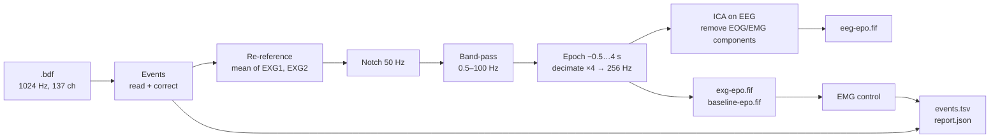

# Preprocessing

`Python_Processing/InnerSpeech_preprocessing.py` turns the raw `.bdf` recordings into the
files of `derivatives/`. The published derivatives were made with its default settings,
so you only need to run it to make a **different** version: other filters, another
reference, no ICA, a different EMG threshold.



## The steps

1. **Events.** The triggers are read from the Status channel and checked against the
   protocol; missing ones are restored and the per-session exceptions applied (see
   [Event codes](../dataset/events.md#missing-triggers-and-how-they-are-restored)). This
   gives the trial table and the first report fields: recording time, right and wrong
   answers, and the list of corrections.
2. **Re-reference** to the mean of the two ear-lobe electrodes (EXG1, EXG2). BioSemi
   records without a reference, so this removes the common-mode signal and reduces line
   noise and drifts.
3. **Notch filter** at 50 Hz, the power line frequency in Argentina.
4. **Band-pass filter**, 0.5–100 Hz (zero-phase FIR). The band is wide on purpose, so
   that users can filter further for their own analysis.
5. **Epochs** from 0.5 s before to 4 s after each cue (the whole trial: concentration to
   the end of relax), decimated by 4 to 256 Hz. The 8 external channels are saved
   separately with a baseline correction on the 0.5 s before the cue, and the 15 s
   baseline of the session as one more epoch.
6. **ICA** (extended Infomax, all components, fixed random seed) on the EEG trials.
   Components correlated with the eye channels (EXG3–EXG6) or the mouth channels
   (EXG7–EXG8) are removed. This takes hours per session.
7. **EMG control.** For inner speech and visualized trials, the power of the mouth
   channels (filtered 1–20 Hz, rectified) in 0.5 s windows sliding by 0.05 s over the
   action interval is compared with the same measure in the baseline. A trial is tagged
   when its mean power exceeds the baseline mean + 3 SD on either channel. The trials
   are tagged, not removed.
8. **Save** the epochs (`*-epo.fif`), the trial table (`events.tsv`) and the report
   (`report.json`), plus the legacy `events.dat` and `report.pkl`.

## Settings

All settings are variables at the top of the script.

| Variable | Default | Meaning |
| --- | --- | --- |
| `N_Subj_arr`, `N_block_arr` | 1–10, 1–3 | Subjects and sessions to process |
| `save_dir` | `ds003626/derivatives` | Output folder; **change it** to keep the published files |
| `FILTER_BOOL`, `LOW_CUT`, `HIGH_CUT` | `True`, 0.5, 100 | Band-pass filter (Hz) |
| `NOTCH_BOOL` | `True` | 50 Hz notch filter |
| `DS_RATE` | 4 | Decimation factor (1024 Hz → 256 Hz) |
| `ICA_BOOL` | `True` | Run ICA (hours per session) |
| `ICA_COMPONENTS`, `ICA_METHOD`, `fit_params` | `None`, `"infomax"`, extended | ICA settings |
| `RANDOM_STATE` | 23 | ICA seed (reproducibility) |
| `EMG_FILTER_LOW_CUT`, `EMG_FILTER_HIGH_CUT` | 1, 20 | EMG band (Hz) |
| `WINDOW_LEN`, `WINDOW_STEP` | 0.5, 0.05 | EMG sliding window (s) |
| `STD_TIMES` | 3 | EMG threshold in baseline standard deviations |
| `N_JOBS` | −1 | CPU cores for filtering (results do not depend on it) |
| `SAVE_LEGACY_FILES` | `True` | Also write `events.dat` and `report.pkl` |

## Make your own version

```bash
# 1. raw data next to the repository
python Raw_data_download_tutorial.py
# 2. edit the variables at the top of the script, set save_dir to a new folder
# 3. run it
uv run python Python_Processing/InnerSpeech_preprocessing.py
```

For a quick look, process one session without ICA first (`N_Subj_arr = [1]`,
`N_block_arr = [1]`, `ICA_BOOL = False`): that takes minutes instead of hours.

!!! tip "Point the loaders to your folder"

    The loaders take the dataset folder and read `<folder>/derivatives`. To read your
    own version, give `save_dir` the same layout, e.g. `my_version/derivatives`, and
    pass `my_version` as `root`.
